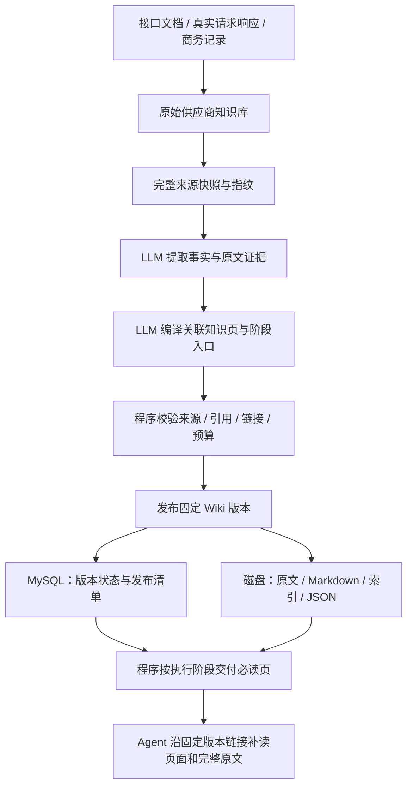

# 当前 LLM Wiki 的存储与中间件

## 1. 这里用的是什么

LLM Wiki 是把原始材料通过模型编译为可导航知识页的组织方式，不是一个必须安装的数据库产品。本项目参考已调研的开源实现，在现有 Java 应用中实现供应商 Wiki 编译与读取，没有另部署一台 Wiki 服务。

当前组成是：**现有模型执行实例 + Java 编译/校验服务 + 普通 MySQL + 本地文件目录**。没有调用 embedding 模型，没有向量索引或向量相似度查询，也没有新增向量数据库、图数据库、Redis 或消息队列。

知识编译确实会调用模型，通过 `ClaudeCodeService.chatInLane` 使用绑定的实例；需要该实例已配置可用的 Claude CLI、登录与模型访问。代码支持并不等于新安装机器已经完成这些授权。

## 2. 与之前的向量 RAG 有何不同

| 环节 | 常见向量 RAG | 当前实现 |
| --- | --- | --- |
| 材料处理 | 经常分块，再生成 embedding | 逐份完整来源提取事实与证据，再跨来源编译知识页 |
| 索引 | 向量索引及相似度查询 | 分类目录、页面链接、来源引用和显式阶段入口 |
| 执行时取材料 | 按问题召回相关片段 | 程序先交付关键页和当前阶段入口，细节沿链接读取 |
| 主要存储 | 常用向量库，也可能由其他数据库承载 | MySQL 记录和 Markdown/JSON 文件 |
| 需要关注的质量 | 解析、分块、召回与生成 | 解析、编译遗漏、引用正确性、更新和页面导航 |

RAG 不一定需要单独的向量数据库；这里解释的是你此前使用的向量 RAG 与当前项目的区别。当前 Wiki 没有进行向量召回，所以无需为它额外部署 Qdrant、Milvus 等服务。

## 3. 编译和使用链路



各服务的职责：

- `SupplierWikiSources` 读取已解析的供应商材料；网站来源会包含已加载子页面的正文。未就绪或不可读来源明确失败。
- `SupplierWikiService` 创建原文快照、复用未变化来源的提取缓存、调用模型合成知识页，并由应用负责最终写入与发布。
- `SupplierWikiContract` 检查页面 ID、逐字引用、来源覆盖、内部链接、关键页和阶段入口。
- `SupplierKnowledgeService` 按工作创建时固定的 TEXT/WIKI 模式交付上下文并记录执行信息。
- `SupplierWorkflowWorker` 在受管理工作流派发自动节点前检查 Wiki 就绪状态；需要时编译并等待，失败后转人工待办。

普通 Wiki 工作可手动点击编译；修改原始材料不会无条件在后台持续调用模型。来源或规则变化会在检查时使旧版本不可用于新的 Wiki 执行；不会默默退回 TEXT。

## 4. 内容实际存在哪里

| 内容 | 位置 |
| --- | --- |
| 工作、知识模式、来源索引 | MySQL 的供应商相关表 |
| Wiki 版本、状态、源指纹、发布清单 | `supplier_wiki_revision`；发布清单包含页面结构/内容等信息 |
| 执行模式、交付页、请求大小、模型实际用量 | `supplier_knowledge_run` |
| 工作流、人工任务、通知队列 | 同一 MySQL 的 Flowable `ACT_*` 及 `supplier_workflow_*` 表 |
| 原始知识库正文和解析材料 | `${feishu.kb-dir}` |
| Wiki 的固定版本文件与提取缓存 | `${feishu.kb-dir}/.wiki/` |
| 工作流上传的原始附件 | `${feishu.kb-dir}/.workflow-uploads/` |

Wiki 文件目录示意：

```text
supplier-kb/
  .wiki/
    <供应商编码哈希前24位>/
      instructions.md
      log.md
      extractions/
        <缓存键>.json
      revisions/
        <版本ID>/
          raw/
            <来源ID>.md
          wiki/
            index.md
            index-<分类>.md
            <页面ID>.md
          schema.md
          manifest.json
```

Mac 容器当前默认根目录是 `/app/data/supplier-kb`；Windows 原生运行可以保留自己的目录，例如 `D:/feishu-claude-data/supplier-kb`，通过 `FEISHU_KB_PATH` 指定。

MySQL 虽然保留发布清单，固定版本读取仍依赖磁盘文件及其哈希验证，完整原文也在文件中。因此，**迁移需要数据库与知识库目录一起搬运**，不能只导出 SQL、只复制 `.wiki`，或只同步代码。

## 5. 怎样保证 Agent 接触到对应材料

每次 Wiki 执行前，程序会检查版本与来源/规则指纹，选择关键约束页和当前阶段入口，直接加入实际请求。它不是只给一句“请自行查知识库”。

额外材料有明确的目录、页面 ID、来源 ID 和固定版本读取接口；接口校验供应商归属、版本登记及文件哈希。必读上下文超过预算会失败，不截掉后继续；编译失败、过期或不存在也不能作为可用 Wiki 执行。

这能检查材料是否被交付、版本是否一致，以及引用结构是否成立；不能证明模型已经正确理解、知识编译绝无遗漏，或 Agent 一定主动读完所有补充链接。结构和引用验证不等于语义质量验证。

## 6. 成本与当前验证边界

不新增向量中间件，仍然有模型编译、文件读写、版本维护和备份成本。首次编译需要读原文，后续变化可复用未变来源提取缓存；页面综合整理仍可能产生模型调用。

当前代码与集成测试已验证编译协议、真实 MySQL/文件持久化、来源失效、版本隔离、阶段交付和工作流等待。自动测试使用模型桩；真实供应商材料上的模型质量仍需用 TEXT/WIKI A/B 检查遗漏、产物正确性和返工情况，不能仅凭上下文字符变少判断效果。

相关文档：[Windows 迁移交接](./Windows无Docker迁移交接.md)、[Wiki 使用与 A/B](./供应商LLM-Wiki与AB测试.md)、[持续工作流](./供应商持续工作流.md)。
