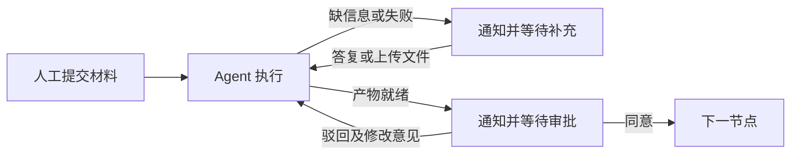

# 供应商持续工作流

供应商工作台现在使用嵌入式 **Flowable BPMN 引擎**管理持续流程。前端、后端、MySQL 仍全部在 OrbStack 运行，无需增加中间件。

## 使用

1. 创建一份供应商工作，照常选择 TEXT / WIKI、执行实例和材料。已有执行记录的工作保留原样，请新建工作启动持续流程。
2. 打开工作详情，顶部“持续工作流”选择飞书通知接收人，点击启动。接收人留空时使用实例的授权用户；没有飞书配置时，可取消勾选，使用工作台待办。
3. 人工节点会生成待办，填写答复或上传所缺文件后点击“提交并继续”。自动节点由流程派发，结果回来后生成审批待办。
4. 同意后进入下一步；驳回时填写修改意见，Agent 会收到意见并重做当前节点；缺信息或执行失败会生成补充信息待办，答复后继续。



启动后请通过流程待办操作节点，原来的自由执行/完成/编辑工件入口会被服务端拦截，避免跳过审批。公司 spec、Skill、Trellis、提示词生成和真实 Postman 执行证据检查继续生效。流程不会因为点击“同意”而接受没有真实执行证据的接口测试。

## 通知与答复

飞书消息包含工作名称、当前节点、需要处理的问题及工作台链接。也可以直接回复机器人：

```text
/供应商 <待办ID> 同意
/供应商 <待办ID> 驳回 请补上取消接口的异常处理
/供应商 <待办ID> 答复 使用供应商沙箱环境
```

命令由程序识别，只允许该流程配置的接收人通过绑定机器人处理，不依赖模型猜测。文件通过消息里的工作台链接上传：支持 PDF 和 UTF-8 的 txt/md/json/csv/yaml/xml/log，单文件不超过 10MB。扫描 PDF 需要先 OCR。

上传的完整原文件保留在应用数据卷中，提取文本进入对应供应商知识库，并记录待办和来源 ID。WIKI 模式会在派发自动节点前编译新增/变化材料，等待就绪后再派发；编译失败则生成待办说明错误。

默认链接是 `http://localhost:18080`。如果要从手机或另一台电脑打开，在私有 `.env.mysql` 配置 `FEISHU_WORKFLOW_PUBLIC_URL` 为可访问本机工作台的地址，再重建后端容器。消息发送仍需实例配置有效的飞书凭证、机器人权限和接收人。

## 暂停、重启与失败

可以暂停、恢复或取消流程。暂停阻止后续流转，已经开始的实例执行仍可能产出结果；取消不会撤销已经发生的外部操作。终止的流程保留记录，需要再次执行时创建新工作。

人工待办和流程位置存储在数据库中。服务重启后，尚未确认结果的执行转为恢复待办，请先核对供应商接口或仓库的实际结果，再明确给出继续/重试指示。系统不会自动重放可能有副作用的外部操作。

通知使用持久发送队列，失败时指数退避重试，最多 6 次；失败原因和手动重试按钮可在工作台查看。重复处理同一待办只允许第一次成功推进。消息投递采用至少一次语义及固定消息 UUID，极端网络故障下仍可能看到重复通知；旧待办不能再次推进流程。

## 存储与实现范围

| 数据 | 位置 |
| --- | --- |
| 流程定义、当前流程位置、人工任务与历史 | 同一 MySQL 数据库的 Flowable `ACT_*` 表 |
| 应用流程、派发记录、通知队列与附件索引 | `supplier_workflow_*` 表 |
| 上传原文件 | `/app/data/supplier-kb/.workflow-uploads/<流程ID>/<待办ID>/` |
| 提取材料与 Wiki | 原有供应商知识库和 Wiki 版本目录 |

现有数据库备份脚本会同时携带流程表和应用数据卷。当前支持按模板节点顺序流转、人工等待、审批和返工回路；没有增加任意 BPMN 拖拽设计器、并行会签或企业 SSO。

技术方案参考 [Flowable 官方源码及版本说明](https://github.com/flowable/flowable-engine/releases/tag/flowable-7.2.0)和[人工任务 API 文档](https://www.flowable.com/open-source/docs/bpmn/ch04-API)。使用适配现有 Spring Boot 3 的 7.2 引擎，不引入 Flowable 商业平台。

验证命令：

```sh
FEISHU_IT_TEST=SupplierWorkflowMysqlIT python3 scripts/tests/run_wiki_mysql.py
FEISHU_IT_TEST=SupplierWorkflowTimerMysqlIT python3 scripts/tests/run_wiki_mysql.py
```

集成测试使用真实 MySQL 和 Flowable，模型执行及飞书发送使用测试桩，不发送真实消息。真实模型产物质量与真实机器人送达，需要配置实例后在业务运行中检验。
